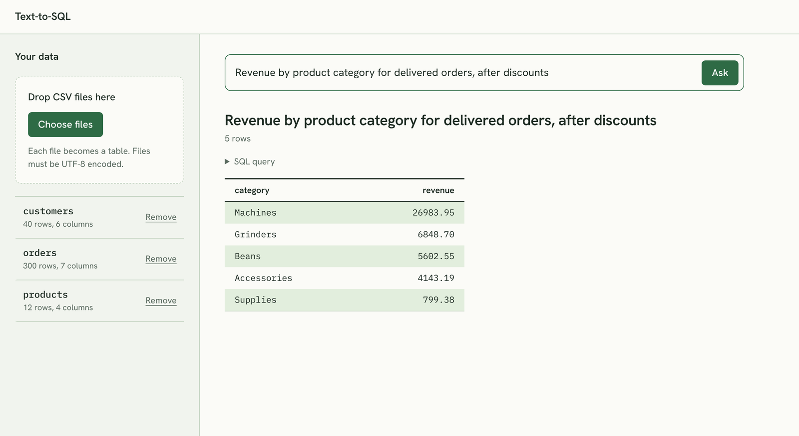

# Text-to-SQL

Ask questions about your CSV files in plain English. An LLM writes the SQL, a guard checks it,
SQLite runs it read-only, and the answer comes back as a table.



- **Upload several CSV files at once.** Each file becomes a table, so questions can join them.
- **Ask in plain English**, for example "Which 3 cities' customers spent the most on delivered orders?"
- **See the answer and the SQL behind it.** The query is one click away, for trust and debugging.
- **Get a clear reason when something fails:** the data can't answer the question, the generated
  query was blocked or broke, the AI service is overloaded.

## How it works

Question → Gemini writes SQL → `sql_guard` checks it → SQLite runs it read-only → table.

1. On upload, each CSV is parsed with pandas (delimiter and types detected, column names
   normalized to `snake_case`) and stored as a table in the workspace's own SQLite file.
2. For a question, the backend sends the model the **schema only**: table and column names, types,
   the original column headers and three sample rows per table. The model never sees the full
   data, and query results never go back to it.
3. The SQL that comes back is treated as untrusted input (see below), executed, and returned with
   its column names so any result renders in the same generic table.

## Safety: the SQL comes from a model

Prompt instructions are not a security boundary, so the SQL is checked and contained in code,
in independent layers:

| Layer | What it does |
|---|---|
| Parse with sqlglot | Exactly one statement, and it must be a query (`SELECT`, `WITH`, `UNION`). `INSERT`, `UPDATE`, `DELETE`, `DROP`, `CREATE`, `ALTER`, `ATTACH`, `PRAGMA` and the rest are rejected, also when nested or appended after a `;`. |
| Hidden tables | Internal tables (`_columns_meta`, `sqlite_master`) and `pragma_*` table functions can't be queried, so the schema behind the app stays private. |
| Read-only connection | Queries run on `mode=ro` with attached databases disabled, so even a guard bug can't write. |
| Row limit | Every query gets a `LIMIT` (1,000 rows by default); the app fetches one extra row to tell the user when the result was cut off. |
| Timeout | A SQLite progress handler stops long-running queries (5 s by default). |
| Value size cap | A single value is capped at 10 MB, so a function like `randomblob(900000000)` fails at once instead of eating memory. |

The test suite includes these attacks: `DROP` smuggled after a `SELECT`, `ATTACH`, `PRAGMA`,
service tables in subqueries, `LIMIT -1`, oversized values and runaway recursive queries.

## Tech stack

| | |
|---|---|
| Backend | Python 3.11+, FastAPI, Pydantic v2, pandas, sqlglot, SQLite |
| AI | Google Gemini via the `google-genai` SDK, behind a small provider interface |
| Frontend | React 19, TypeScript, Vite |
| Quality | pytest, ruff, black; Vitest, Testing Library, ESLint, Prettier |

## Getting started

You need Python 3.11+, Node.js 22.22+ (or 24.15+) and a free Gemini API key.

### 1. Backend

```bash
cd backend
python -m venv .venv
.venv/Scripts/activate        # Windows; on Linux/macOS: source .venv/bin/activate
pip install -r requirements-dev.txt
cp .env.example .env          # then put your API key in .env, see step 2
uvicorn app.main:app --reload --port 8000
```

Run `uvicorn` from `backend/`: that is where it looks for `.env`. Restart it after editing `.env`.
Interactive API docs are at http://localhost:8000/docs.

### 2. Gemini API key

Create a key in [Google AI Studio](https://aistudio.google.com) (Get API key → Create API key)
and put it in `backend/.env`:

```
AI_PROVIDER=gemini
AI_MODEL=gemini-3.5-flash-lite
AI_API_KEY=your-key
```

`gemini-3.5-flash-lite` is the recommended model: it is fast, answers the sample questions
(joins included) correctly, and its free tier allows 15 requests a minute and 500 a day.
Larger models can have much smaller free limits (Gemini 3.8 Flash: 5 a minute, 20 a day).
Your project's current limits are on the [Rate Limit](https://aistudio.google.com/rate-limit)
page in AI Studio; daily limits reset at midnight Pacific time.

`.env` holds your key and is ignored by git. Never commit it.

### 3. Frontend

In a second terminal:

```bash
cd frontend
npm install
npm run dev                   # http://localhost:5173, /api is proxied to :8000
```

### 4. Try it

[`sample-data/`](sample-data/) is a small coffee-equipment store: `customers`, `orders` and
`products` as related CSV files, plus 12 questions with known answers, from simple counts to
three-table joins with missing discounts, an unanswerable question and a delete attempt.
Upload all three files at once and compare the app's answers with the table in its README.

## Configuration

All settings come from `backend/.env` (see [`.env.example`](backend/.env.example)):

| Variable | Default | Meaning |
|---|---|---|
| `AI_PROVIDER` | `gemini` | AI provider |
| `AI_MODEL` | `gemini-3.5-flash-lite` | Model name; never hard-coded |
| `AI_API_KEY` | — | Provider API key |
| `AI_TIMEOUT_SECONDS` | `30` | Timeout for one AI request |
| `AI_MAX_ATTEMPTS` | `2` | Attempts per AI request when the model is overloaded (5xx); `1` disables retries. Failed requests count toward the quota. |
| `DATA_DIR` | `./data` | Where workspace databases are stored |
| `MAX_UPLOAD_MB` | `50` | Maximum size of one uploaded file |
| `MAX_RESULT_ROWS` | `1000` | Maximum rows returned for one question |
| `QUERY_TIMEOUT_SECONDS` | `5` | Maximum run time of one SQL query |
| `CORS_ORIGINS` | `http://localhost:5173` | Allowed browser origins, comma-separated |

## API

| Method | Path | Description |
|---|---|---|
| `POST` | `/api/workspaces` | Create a workspace → `{ workspace_id }` |
| `POST` | `/api/workspaces/{id}/files` | Upload one or more CSV files (multipart, field `files`) |
| `GET` | `/api/workspaces/{id}/schema` | Tables with columns, types, row counts and sample rows |
| `DELETE` | `/api/workspaces/{id}/tables/{table}` | Remove a table |
| `POST` | `/api/workspaces/{id}/query` | `{ question }` → `{ sql, columns, rows, row_count, truncated }` |

Errors share one format: `{ "error": { "code": "...", "message": "..." } }`, with codes such as
`INVALID_FILE`, `SQL_NOT_ALLOWED`, `SQL_EXECUTION_ERROR`, `AI_ERROR` and `WORKSPACE_NOT_FOUND`.
When the generated SQL was blocked or failed, the error also carries that `sql`.

## Project structure

```
backend/
  app/
    api/          # thin FastAPI routers
    ai/           # provider interface, prompt, Gemini provider
    services/     # ingest, schema, sql_guard, query execution
    models/       # Pydantic request and response models
  tests/
frontend/
  src/
    api/          # typed API client
    hooks/        # workspace and question state
    components/   # upload, table list, question box, results, SQL preview
sample-data/      # demo CSV files with questions and expected answers
```

## Development

```bash
# backend/
pytest
ruff check . && black --check .

# frontend/
npm test
npm run lint && npm run format:check && npm run build
```

Backend tests use a fake AI provider and ignore `.env`, so they never call a real model.

## Limitations

- **No authentication.** A workspace is identified only by a random ID stored in the browser.
  This is built for running locally, not for exposing to the internet.
- **CSV only.** Excel support (one table per sheet) is planned.
- **One AI provider.** The provider interface is ready for others; OpenAI is planned.
- **English data and questions.** Files must be UTF-8.
- **Small to medium data.** SQLite is plenty for files up to the upload limit; larger data
  would call for DuckDB or PostgreSQL.
- **Model mistakes are possible.** The SQL is always shown so an answer can be checked.
